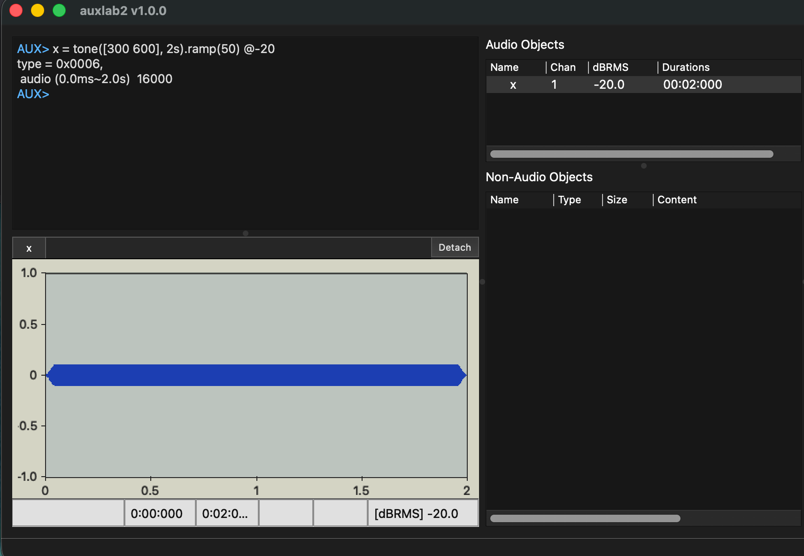
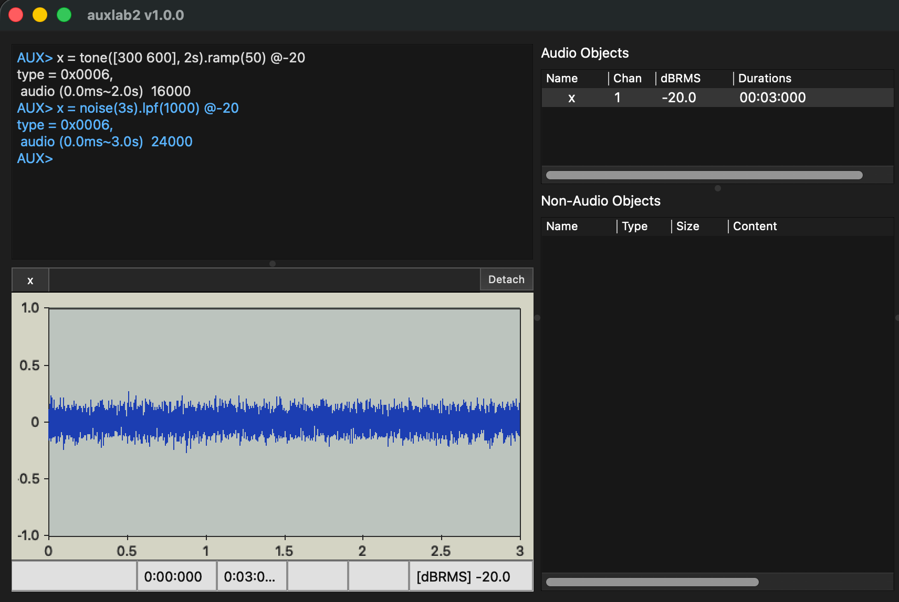

# AUXLAB2

AUXLAB2 is a desktop workbench for writing and debugging AUX scripts, exploring waveforms, and experimenting with audio signal processing.

## AUX, AUXLAB, and AUXLAB2

### AUX

AUX (AUdio syntaX) is a scripting language for audio signal processing with MATLAB-like syntax. It supports numeric vectors and matrices as well as audio objects that carry their sample rate, channel layout, and timing. You can generate, filter, and combine signals and work with audio in units such as milliseconds. The AUX Engine (`auxe`) parses and runs the language. [AUX Engine repository](https://github.com/bjkwon/aux_engine)

### AUXLAB (legacy)

AUXLAB is the original Windows application for AUX. Its MATLAB-inspired interface combines an interactive command window with tools for generating, viewing, processing, and playing audio signals. [Legacy AUXLAB repository](https://github.com/bjkwon/auxlab)

### AUXLAB2

AUXLAB2 is the Qt 6 workbench for AUX on macOS, Linux, and Windows. It embeds the AUX Engine and includes the following tools.

- An `AUX>` console with persistent command history and a workspace variable browser.
- Waveform plots and signal tables, with zoom, pan, and time-range selection in plots.
- Audio playback and recording, including playback of a selected waveform range.
- A debugger for user-defined functions (UDFs) with breakpoints, step controls, and local variable inspection.

## Requirements

- CMake 3.21 or newer and a C++17 compiler.
- Qt 6.5 or newer with the Widgets and Multimedia modules. The recording code uses Qt's microphone permission API. [Qt microphone permission API](https://doc.qt.io/qt-6/qmicrophonepermission.html)
- FFTW3, libsamplerate, and nlohmann-json development packages. Install a nlohmann-json package that provides CMake configuration files.
- Git to clone the source repositories.

Playback requires an audio output device. Recording requires an audio input device and microphone access where the operating system prompts for it.

## Build and run

Clone both repositories into the same parent directory. Keep the checkout named `aux_engine` next to `auxlab2` so CMake can build the engine from that sibling source tree.

```sh
git clone https://github.com/bjkwon/aux_engine.git
git clone https://github.com/bjkwon/auxlab2.git
cd auxlab2
```

Run the commands for your platform from the `auxlab2` directory.

### macOS with Homebrew

Install the Xcode Command Line Tools with `xcode-select --install` if needed, then install the dependencies. [Homebrew Qt formula](https://formulae.brew.sh/formula/qt)

```sh
brew install cmake qt fftw libsamplerate nlohmann-json
cmake -S . -B build -DCMAKE_BUILD_TYPE=Release \
  -DCMAKE_PREFIX_PATH="$(brew --prefix qt);$(brew --prefix fftw);$(brew --prefix libsamplerate);$(brew --prefix nlohmann-json)" \
  -DCMAKE_CXX_FLAGS="-I\"$(brew --prefix fftw)/include\""
cmake --build build --config Release --parallel --target auxlab2
./build/auxlab2
```

The compiler flag exposes Homebrew's `fftw3.h` to the AUX Engine build. You can also open `build/auxlab2.app` from Finder.

### Linux

Install the development packages for your distribution. The example below uses Ubuntu 26.04. [Ubuntu Qt Multimedia package](https://packages.ubuntu.com/resolute/qt6-multimedia-dev)

```sh
sudo apt install build-essential cmake qt6-base-dev qt6-multimedia-dev \
  libfftw3-dev libsamplerate0-dev nlohmann-json3-dev
cmake -S . -B build -DCMAKE_BUILD_TYPE=Release
cmake --build build --config Release --parallel --target auxlab2
./build/auxlab2
```

If you installed Qt separately, pass `-DCMAKE_PREFIX_PATH=/path/to/qt` when configuring.

### Windows with Visual Studio and vcpkg

Install Visual Studio 2022 with **Desktop development with C++**, CMake, and a 64-bit Qt 6 build for MSVC 2022 with Qt Multimedia. Install and bootstrap vcpkg, set `VCPKG_ROOT` to its directory, then run the commands in Developer PowerShell for Visual Studio. Set `$qtPrefix` to your Qt kit directory. [Qt deployment on Windows](https://doc.qt.io/qt-6/windows-deployment.html)

```powershell
$qtPrefix = 'C:\Qt\6.10.1\msvc2022_64'
$env:Path = "$qtPrefix\bin;$env:Path"
& "$env:VCPKG_ROOT\vcpkg.exe" install fftw3:x64-windows libsamplerate:x64-windows nlohmann-json:x64-windows

cmake -S . -B build -G "Visual Studio 17 2022" -A x64 `
  "-DCMAKE_PREFIX_PATH=$qtPrefix" `
  "-DCMAKE_TOOLCHAIN_FILE=$env:VCPKG_ROOT/scripts/buildsystems/vcpkg.cmake"
cmake --build build --config Release --parallel --target auxlab2
& "$qtPrefix\bin\windeployqt.exe" --release .\build\Release\auxlab2.exe
& .\build\Release\auxlab2.exe
```

For installers, archives, and distribution builds, see the [release and packaging guide](RELEASE.md).

## Try it

Enter these commands at the `AUX>` prompt to create a two-second tone glide from 300 Hz to 600 Hz, with a smoothed onset and offset, scaled to -20 dB relative to full scale. Then plot and play it.

```aux
x = tone([300 600], 2s).ramp(50) @-20
plot(x)
play(x)
```

Better yet, in the "Audio Objects" list, click the "x" row and press Enter to plot the waveform. Once it is plotted, press the spacebar to play it.



Plots created from the object lists update automatically when the object changes. Try changing `x` to low-pass noise with a cutoff frequency of 1000 Hz.

```aux
x = noise(3s).lpf(1000) @-20
```

You'll notice the waveform updates when you enter the new command. This is one of AUXLAB's many useful features compared to MATLAB.



## Documentation

- Learn AUX syntax, audio objects, and scripting in the [AUX User Guide](https://github.com/bjkwon/aux_engine/blob/main/user-docs/AUX_User_Guide.md).
- Look up built-in functions and their arguments in the [AUX Function Reference](https://github.com/bjkwon/aux_engine/blob/main/user-docs/AUX_Function_Reference.md).
- Learn the console, variable browser, graph controls, and debugger in the [AUXLAB2 GUI and Debugging Tutorial](TUTORIAL_GUI_AND_DEBUGGING.md).
- Process audio in blocks with callbacks using the [`progblocks` guide](PROGBLOCKS.md).
- Load or develop native extensions using the [external modules guide](https://github.com/bjkwon/aux_engine/blob/main/docs/external_modules.md).
